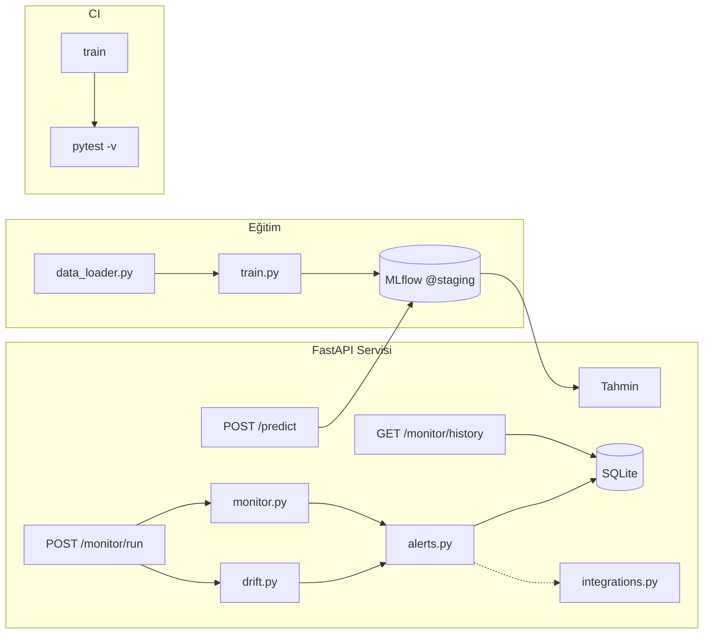

# ModelWatch

**FastAPI**, **MLflow**, **Evidently**, **scikit-learn**, **SQLite**, **Docker** ve **GitHub Actions** kullanılarak geliştirilmiş, üretime yönelik **makine öğrenmesi izleme, veri kayması (data drift) analizi, alarm üretimi ve çıkarım (inference) servisi**.

> **Veri Notu:** Varsayılan `src/data_loader.py` akışı sentetik veri üretir. Gerçek veya dış üretim kayıtları `/monitor/run` isteğindeki `records` alanı üzerinden gönderilebilir.

## Mimari Akış

## Ortam Değişkenleri

| Değişken | Varsayılan | Açıklama |
| --- | --- | --- |
| `MLFLOW_TRACKING_URI` | `sqlite:///mlflow.db` | MLflow tracking ve registry URI'si |
| `MODELWATCH_MODEL_NAME` | `ModelWatch-CustomerSatisfaction` | Kayıtlı MLflow model adı |
| `MODELWATCH_MODEL_ALIAS` | `staging` | Kullanılacak model alias'ı |
| `MODELWATCH_HISTORY_DB` | `data/modelwatch_history.db` | SQLite geçmiş veritabanı yolu |
| `MODELWATCH_WEBHOOK_URL` | *(opsiyonel)* | Alarm webhook hedef URL'si |

## API Uç Noktaları

| Metot | Uç Nokta | Açıklama |
| --- | --- | --- |
| `GET` | `/health` | Servis sağlık durumu (`200` hazır, `503` model hazır değilse) |
| `POST` | `/predict` | `@staging` modeli ile tekil müşteri memnuniyeti tahmini |
| `POST` | `/monitor/run` | Drift analizi, model izleme, alarm üretimi, bildirim ve SQLite kaydı |
| `GET` | `/monitor/history?limit=10` | SQLite veritabanından son izleme koşularını getirir |

## Mühendislik Notları ve Sınırlamalar

- **Bağımlılık Sabitleme (`pandas<3.0`, `mlflow>=3.0`):** `evidently==0.7.23` ile `pandas` 2.x uyumluluğu ve MLflow 3 registry alias akışı korunur; tek bağımlılık kaynağı `pyproject.toml` dosyasıdır.
- **Küçük Örneklem Hassasiyeti:** Düşük `n_samples` değerlerinde Wasserstein mesafesi örnekleme varyansı nedeniyle kayma eşiğini daha sık geçebilir.
- **Yerel Kalıcılık ve Güvenlik:** SQLite yerel geliştirme içindir; üretim ortamlarında PostgreSQL ve kimlik doğrulama eklenmelidir.

Örnek izleme çıktısı için `docs/sample_monitoring_run.json` ve lisans için [MIT Lisansı](./LICENSE) dosyasına bakabilirsiniz.
