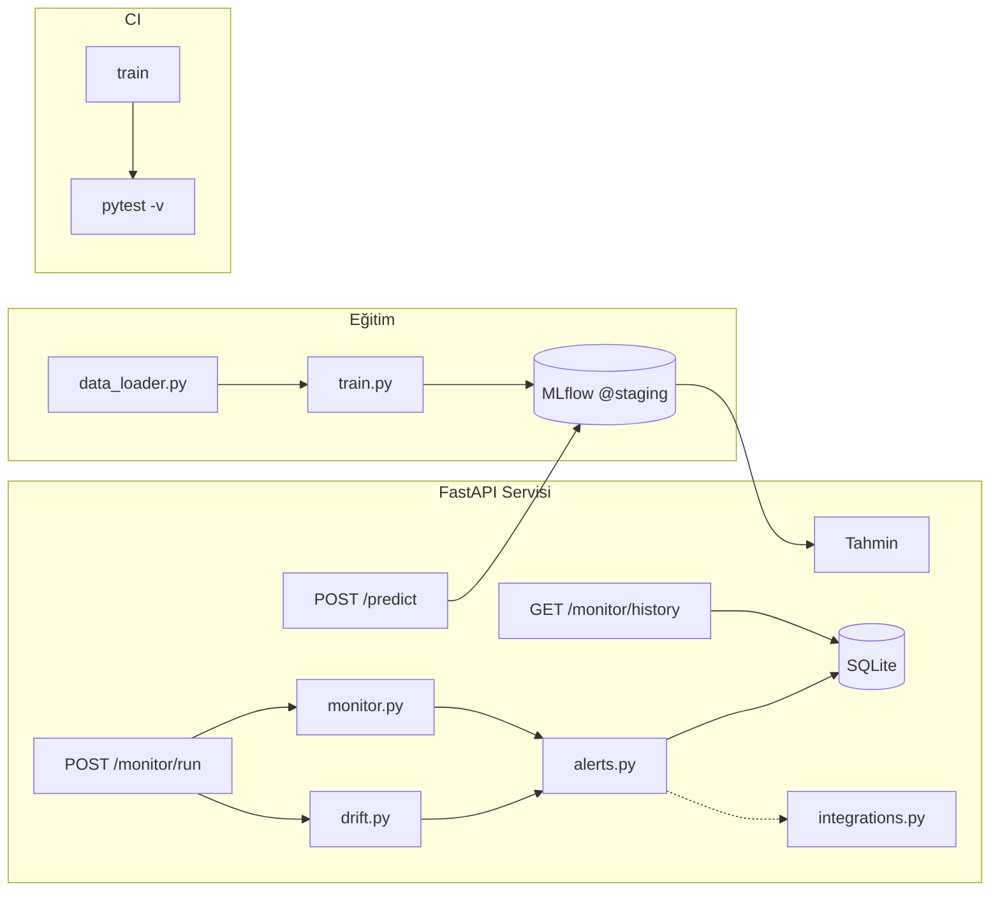

# ModelWatch

[](https://github.com/almina-nur/modelwatch/actions/workflows/ci.yml)

**FastAPI**, **MLflow**, **Evidently**, **scikit-learn**, **SQLite**, **Docker** ve **GitHub Actions** kullanılarak geliştirilmiş, üretime yönelik **makine öğrenmesi izleme, veri kayması (data drift) analizi, alarm üretimi ve çıkarım (inference) servisi**.

> **Veri Notu:** Varsayılan `src/data_loader.py` akışı sentetik veri üretir. Gerçek veya dış üretim kayıtları `/monitor/run` isteğindeki `records` alanı üzerinden gönderilebilir.

## Mimari Akış



## Ortam Değişkenleri

| Değişken | Varsayılan | Açıklama |
| --- | --- | --- |
| `MLFLOW_TRACKING_URI` | `sqlite:///mlflow.db` | MLflow tracking ve registry URI'si |
| `MODELWATCH_MODEL_NAME` | `ModelWatch-CustomerSatisfaction` | Kayıtlı MLflow model adı |
| `MODELWATCH_MODEL_ALIAS` | `staging` | Kullanılacak model alias'ı |
| `MODELWATCH_HISTORY_DB` | `data/modelwatch_history.db` | SQLite geçmiş veritabanı yolu |
| `MODELWATCH_WEBHOOK_URL` | *(opsiyonel)* | Alarm webhook hedef URL'si |
| `MODELWATCH_API_KEY` | *(opsiyonel)* | Tanımlıysa `/monitor/run` için `X-API-Key` kontrolü |

## API Uç Noktaları

| Metot | Uç Nokta | Açıklama |
| --- | --- | --- |
| `GET` | `/health` | Servis sağlık durumu (`200` hazır, `503` model hazır değilse) |
| `POST` | `/predict` | `@staging` modeli ile tekil müşteri memnuniyeti tahmini |
| `POST` | `/monitor/run` | Drift analizi, model izleme, alarm üretimi, bildirim ve SQLite kaydı |
| `GET` | `/monitor/history?limit=10` | SQLite veritabanından son izleme koşularını getirir |

### Örnek `/predict` İsteği

```bash
curl -X POST "http://localhost:8000/predict" \
  -H "Content-Type: application/json" \
  -d '{
    "yas": 0.4,
    "gelir": 1.2,
    "abonelik_suresi": -0.3,
    "aylik_ucret": 0.8,
    "destek_talebi_sayisi": -0.5,
    "son_etkilesim_gun": 0.1,
    "kullanilan_hizmet": 0.6,
    "memnuniyet_skoru": 1.1
  }'
```

### Örnek `/monitor/run` İsteği

```bash
curl -X POST "http://localhost:8000/monitor/run" \
  -H "Content-Type: application/json" \
  -d '{
    "n_samples": 1000,
    "drift": true,
    "random_state": 7,
    "save_html": false
  }'
```

## Kurulum, Test ve Docker

```bash
pip install -e '.[dev]'
python -m src.train
uvicorn api.main:app --reload --host 0.0.0.0 --port 8000
ruff check src api tests && ruff format --check src api tests && pytest
```

## Mühendislik Notları ve Sınırlamalar

- **Tek Bağımlılık Kaynağı (`pyproject.toml`):** `mlflow>=3.0`, `pandas<3.0` ve `evidently==0.7.23` sürümleri tek kaynakta tanımlanır; test kapsamı `pytest-cov` ile raporlanır.
- **Küçük Örneklem Hassasiyeti:** `MIN_RECOMMENDED_ROWS = 250` altındaki örneklemlerde uyarı üretilir; düşük `n_samples` değerlerinde Wasserstein mesafesi gürültülü olabilir.
- **Yerel Kalıcılık ve Güvenlik:** SQLite ve opsiyonel `MODELWATCH_API_KEY` yerel geliştirme ve portfolyo gösterimleri içindir; üretim ortamlarında PostgreSQL ve kapsamlı kimlik doğrulama kullanılmalıdır.

Örnek izleme çıktısı için `docs/sample_monitoring_run.json` ve lisans için [MIT Lisansı](./LICENSE) dosyasına bakabilirsiniz.
