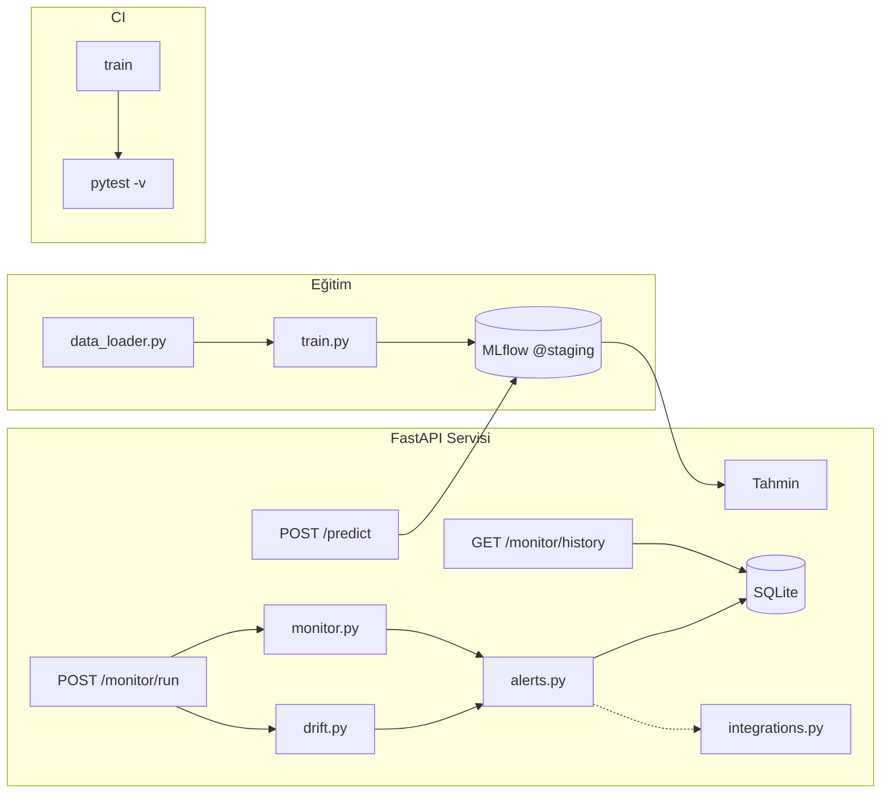

# ModelWatch

[](https://github.com/almina-nur/modelwatch/actions/workflows/ci.yml)

**FastAPI**, **MLflow**, **Evidently**, **scikit-learn**, **SQLite**, **Docker** ve **GitHub Actions** ile geliştirilmiş makine öğrenmesi izleme, veri kayması analizi, alarm üretimi ve çıkarım servisi.

> **Veri Notu:** Varsayılan `src/data_loader.py` akışı sentetik veri üretir. Gerçek kayıtlar `/monitor/run` isteğindeki `records` alanı üzerinden gönderilebilir.

## Mimari Akış



## API Uç Noktaları

| Metot | Uç Nokta | Açıklama |
| --- | --- | --- |
| `GET` | `/health` | Servis sağlık durumu (`200` hazır, `503` model hazır değilse) |
| `POST` | `/predict` | `@staging` modeli ile tekil tahmin |
| `POST` | `/monitor/run` | Drift analizi, model izleme, alarm, bildirim ve SQLite kaydı |
| `GET` | `/monitor/history?limit=10` | Son izleme koşularını getirir |

### Örnek `/monitor/run` İsteği

```bash
curl -X POST "http://localhost:8000/monitor/run" -H "Content-Type: application/json" -d '{"n_samples": 1000, "drift": true, "random_state": 7, "save_html": false}'
```

## Mühendislik Notları ve Sınırlamalar

- **Bağımlılık Sabitleme:** `pandas<3.0` ve `mlflow>=3.0` ile uyumluluk korunur; tek bağımlılık kaynağı `pyproject.toml` dosyasıdır.
- **Küçük Örneklem Hassasiyeti:** Düşük `n_samples` değerlerinde Wasserstein mesafesi örnekleme varyansı nedeniyle daha hassas davranabilir.
- **Kalıcılık ve Güvenlik:** SQLite yerel geliştirme içindir; üretimde PostgreSQL ve kimlik doğrulama eklenmelidir.

Örnek çıktı için `docs/sample_monitoring_run.json` ve lisans için [MIT Lisansı](./LICENSE) dosyasına bakabilirsiniz.
