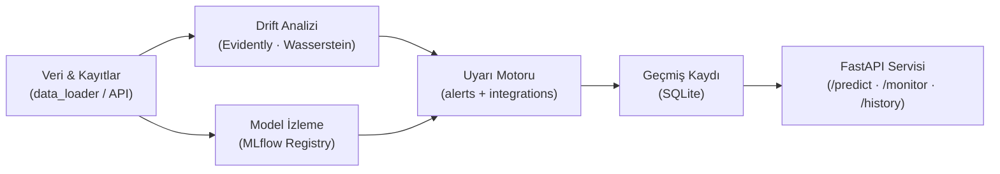

# ModelWatch

Veri kayması (*data drift*) analizi, MLflow kayıtlı model izleme, seviyeli uyarı üretimi, SQLite geçmiş kaydı ve FastAPI tahmin/izleme uçları sunan MLOps izleme servisi.

> **Veri Notu:** Varsayılan `src/data_loader.py` akışı sentetik veri üretir. Gerçek veya dış üretim kayıtları `/monitor/run` isteğindeki `records` alanı üzerinden gönderilebilir.

## Mimari



## Modüller

* **`src/drift.py`**: Referans ve üretim verisi arasındaki dağılım değişimini Evidently ile ölçer.
* **`src/train.py` & `src/monitor.py**`: Modeli eğitip MLflow Registry'ye kaydeder; alias üzerinden yüklenen modelin tahmin ve performans metriklerini izler.
* **`src/alerts.py` & `src/integrations.py**`: Kayma ve metrik durumuna göre uyarı seviyeleri üretir; isteğe bağlı webhook ve JSON log bildirimi gönderir.
* **`src/storage.py`**: İzleme çalıştırmalarını ve uyarı özetlerini SQLite veritabanında saklar.
* **`api/main.py`**: `/predict`, `/monitor/run` ve `/monitor/history` uçlarını sunar.

## Ortam Değişkenleri

| Değişken | Varsayılan | Açıklama |
| --- | --- | --- |
| `MLFLOW_TRACKING_URI` | `sqlite:///mlflow.db` | MLflow tracking ve registry URI'si |
| `MODELWATCH_MODEL_NAME` | `ModelWatch-CustomerSatisfaction` | Kayıtlı MLflow model adı |
| `MODELWATCH_MODEL_ALIAS` | `staging` | Kullanılacak model alias'ı |
| `MODELWATCH_HISTORY_DB` | `data/modelwatch_history.db` | SQLite geçmiş veritabanı yolu |
| `MODELWATCH_WEBHOOK_URL` | *(opsiyonel)* | Alarm webhook hedef URL'si |

## Kurulum, Test ve Çalıştırma

```bash
pip install -e ".[dev]"
python -m src.train
uvicorn api.main:app --reload
ruff check src api tests && ruff format --check src api tests && pytest -v

```

## Docker

```bash
docker build -t modelwatch:latest .
docker run --rm -p 8000:8000 modelwatch:latest

```

Örnek izleme çıktısı için `docs/sample_monitoring_run.json` ve lisans için [MIT Lisansı](https://www.google.com/search?q=LICENSE) dosyasına bakabilirsiniz.

```
