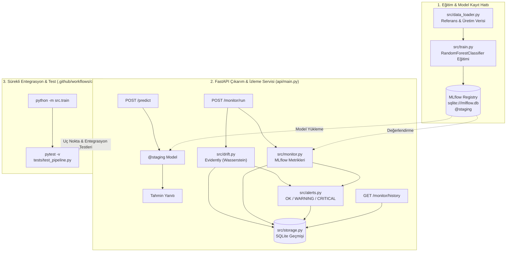

# ModelWatch

[](https://github.com/almina-nur/modelwatch/actions/workflows/ci.yml)

**FastAPI**, **MLflow**, **Evidently**, **scikit-learn**, **SQLite**, **Docker** ve **GitHub Actions** kullanılarak geliştirilmiş, üretime yönelik **makine öğrenmesi izleme, veri kayması (data drift) analizi, alarm üretimi ve çıkarım (inference) servisi**.

ModelWatch; kayıtlı `@staging` modeli üzerinden özellik dağılım kaymalarını (Wasserstein mesafesi) ve sınıflandırma metriklerini izler, kural tabanlı alarm seviyeleri (`OK`, `WARNING`, `CRITICAL`) üretir, izleme koşularını SQLite üzerinde saklar ve REST API uçları sunar.

---

## Mimari Akış



---

## Temel Yetenekler

- **Model Eğitimi ve Kayıt (`src/train.py`):** Müşteri memnuniyeti verisi üzerinde `RandomForestClassifier` eğitir, parametre ve metrikleri MLflow (`sqlite:///mlflow.db`) üzerine kaydeder, `ModelWatch-CustomerSatisfaction` modelini kaydeder ve `@staging` alias atar.
- **Veri Kayması Analizi (`src/drift.py`):** Referans ve üretim verisi dağılımlarını `Evidently` (`0.7.23`) ve Wasserstein eşiği (`>= 0.1`) ile karşılaştırır; sütun bazlı kayma detaylarını ve genel kayma oranını üretir.
- **Model Performans İzleme (`src/monitor.py`):** `@staging` modelini kullanarak `accuracy`, `f1`, `precision`, `recall` metriklerini ve pozitif sınıf tahmin oranını hesaplar.
- **Seviyeli Alarm Motoru (`src/alerts.py`):** Kayma ve performans sonuçlarına göre `OK`, `WARNING` veya `CRITICAL` alarm durumu ve detay listesi oluşturur.
- **Geçmiş Kaydı (`src/storage.py`):** İzleme koşularını `data/modelwatch_history.db` (SQLite) veritabanına kaydeder ve `GET /monitor/history` üzerinden sunar.
- **REST API (`api/main.py`):** `/health`, `/predict`, `/monitor/run` ve `/monitor/history` uç noktalarını sağlar.
- **Otomatik Test ve CI (`tests/test_pipeline.py`, `.github/workflows/ci.yml`):** Her `push` ve `pull_request` işleminde veri şeması, drift tespiti, alarm kuralları, SQLite kayıt/okuma döngüsü ve FastAPI uçlarını test eder.

---

## Proje Yapısı

```text
modelwatch/
├── .github/workflows/
│   └── ci.yml              # GitHub Actions CI (model eğitimi + pytest)
├── api/
│   └── main.py             # FastAPI uygulaması ve uç noktaları
├── src/
│   ├── __init__.py
   ├── alerts.py           # OK / WARNING / CRITICAL alarm kuralları
   ├── data_loader.py      # Referans ve üretim veri üreticileri
   ├── drift.py            # Evidently veri kayması analizi
   ├── monitor.py          # MLflow @staging model değerlendirmesi
   ├── storage.py          # SQLite kalıcılık katmanı
   └── train.py            # Model eğitimi ve MLflow Registry alias atama
├── tests/
│   └── test_pipeline.py    # Otomatik pytest test paketi
├── Dockerfile
├── requirements.txt
└── README.md
```

---

## Hızlı Başlangıç

### 1. Bağımlılıkları Kurun

```bash
git clone https://github.com/almina-nur/modelwatch.git
cd modelwatch
python -m venv .venv
source .venv/bin/activate  # Windows PowerShell için: .venv\Scripts\Activate.ps1
pip install --upgrade pip
pip install -r requirements.txt
pip install pytest httpx
```

### 2. `@staging` Modelini Eğitin ve Kaydedin

```bash
python -m src.train
```

### 3. Testleri Çalıştırın

```bash
pytest -v
```

### 4. FastAPI Servisini Başlatın

```bash
uvicorn api.main:app --reload --host 0.0.0.0 --port 8000
```

Etkileşimli API dokümantasyonuna `http://localhost:8000/docs` adresinden ulaşabilirsiniz.

---

## API Uç Noktaları

| Metot | Uç Nokta | Açıklama |
| --- | --- | --- |
| `GET` | `/health` | Servis sağlık durumu ve aktif model/alias bilgisi |
| `POST` | `/predict` | `@staging` modeli ile tekil müşteri memnuniyeti tahmini |
| `POST` | `/monitor/run` | Drift analizi, model izleme, alarm üretimi ve SQLite kaydı çalıştırır |
| `GET` | `/monitor/history?limit=10` | SQLite veritabanından son izleme koşularını getirir |

### Örnek `/predict` İsteği

```bash
curl -X POST "http://localhost:8000/predict" \
  -H "Content-Type: application/json" \
  -d '{
    "yas": 0.4,
    "gelir": 1.2,
    "abonelik_suresi": -0.3,
    "aylik_ucret": 0.8,
    "destek_talebi_sayisi": -0.5,
    "son_etkilesim_gun": 0.1,
    "kullanilan_hizmet": 0.6,
    "memnuniyet_skoru": 1.1
  }'
```

### Örnek `/monitor/run` İsteği

```bash
curl -X POST "http://localhost:8000/monitor/run" \
  -H "Content-Type: application/json" \
  -d '{
    "n_samples": 1000,
    "drift": true,
    "random_state": 7,
    "save_html": false
  }'
```

---

## Docker ile Çalıştırma

```bash
docker build -t modelwatch:latest .
docker run -p 8000:8000 modelwatch:latest
```

---

## Mühendislik Notları ve Tercihler

- **Bağımlılık Sabitleme (`pandas<3.0`):** `evidently==0.7.23`, `pandas` 3.x ile kaldırılan iç dtype yardımcılarına başvurduğundan `requirements.txt` içinde `pandas<3.0` sabitlenerek yerel ve CI ortamlarında tekrarlanabilirlik sağlanmıştır.
- **CI Ortamında Model Hazırlığı:** GitHub Actions koşucuları sıfır çalışma alanı ile başladığından, `pytest -v` öncesinde `python -m src.train` çalıştırılarak MLflow Registry'de `@staging` modelinin hazır bulunması garanti altına alınmıştır.
- **Yerel Kalıcılık:** SQLite (`sqlite:///mlflow.db` ve `data/modelwatch_history.db`), yerel geliştirme ve portfolyo sunumları için kurulumu sade tutar; üretim ortamlarında PostgreSQL ve uzak artefakt depolarına geçiş yapılabilir.
